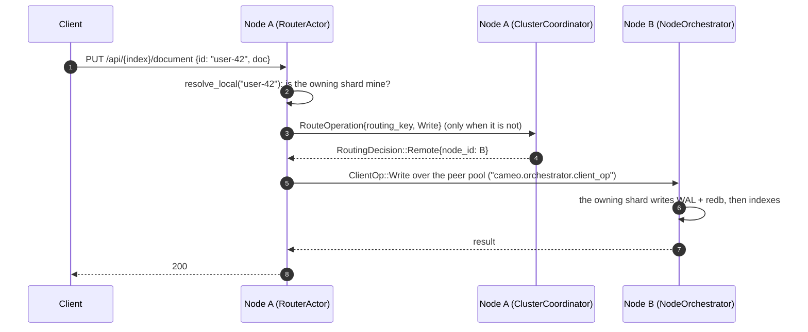
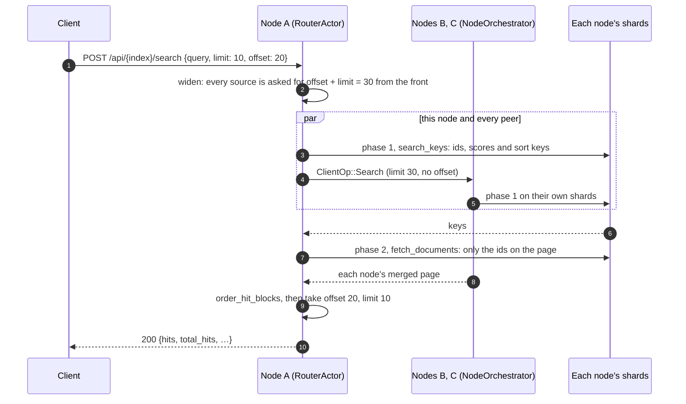

# CameoDB Documentation

What each document in this folder covers, then how a request travels through a cluster: a
write that belongs to another node, and a search that every node answers.

| Document | What it covers |
|---|---|
| [API_REFERENCE.md](API_REFERENCE.md) | Every HTTP route: documents, search, schema, keys and tenants, admin, health |
| [CONFIGURATION.md](CONFIGURATION.md) | `cameodb.toml`, the command-line and environment overrides, and the limits |
| [DEPLOYMENT.md](DEPLOYMENT.md) | Docker, the DEB/RPM/MSI packages, clusters, and key provisioning |
| [MCP.md](MCP.md) | The Model Context Protocol surface for agents; the tool reference is [crates/mcp/README.md](../crates/mcp/README.md) |
| [ARCHITECTURE.md](ARCHITECTURE.md) | The design: hybrid shards, the actors, the cluster |
| [ADR.md](ADR.md) | Architecture decisions, with the alternatives turned down |
| [DEVELOPMENT.md](DEVELOPMENT.md) | Setting up a machine to build, test and validate |
| [BUILDING.md](BUILDING.md) | Static Linux binaries and cross-compilation |
| [ROADMAP-ARCHIVE.md](ROADMAP-ARCHIVE.md) | Delivered roadmap items, with their measurements; open work is in [ROADMAP.md](../ROADMAP.md) |

---

## How a request crosses the cluster

Every node takes every request. Nodes `A`, `B` and `C` below each own some shards; a client talks
to `A`. The names are the ones in `crates/server/src/node/router.rs` and
`crates/server/src/cluster_coordinator/coordinator.rs`.

### A write that belongs to another node

A single document write — `PUT /api/{index}/document` — or delete has a **routing key**: the
document's routing field, `id` unless the schema names another. The consistent-hash ring maps the
key to one shard, and that shard's owner is the only node that may write it.

1. **The handler** resolves the routing key and builds a `ClientOp::Write`.
2. **`route_and_handle`** asks `resolve_local` first: the ring and the shard placement are
   published lock-free, so a key this node owns is written without a message to anyone.
3. **Otherwise `ClusterCoordinator::decide_route`** answers, from the shard map and what it knows
   of each peer:

   | The key's shard is owned by | Decision | The caller sees |
   |---|---|---|
   | this node | `Local` | the write's own answer |
   | a connected peer | `Remote { node_id, peer_addr }` | the peer's answer |
   | a peer that was lost — its connection closed, or it stopped answering pings | `Unavailable { node_id }` | `503`, naming the owner |
   | a node this one has never reached since it started — a peer still joining, or the old identity of a node rebuilt with an empty data directory | `Unavailable { node_id }` | `503`, naming the owner |
   | no shard yet — a ring still forming | `Broadcast`, refused for a write | `503` |

   A write is never broadcast: it would land on every node or on none.
4. **`handle_remote`** sends the op to the owner through the `RemotePeerPool`, under the
   inter-node deadline (`network.cluster.messaging.request_timeout_secs`), retrying up to
   `remote_retry_attempts` times from the same table — but only an attempt that failed
   to *reach* the peer. A peer that answered with an error has answered: the error is returned
   as it is, with the peer's own status. When every attempt fails, the caller gets `503` and the
   coordinator is asked to redial.
5. **On `B`**, the op arrives at `NodeOrchestrator` through the remote message
   `cameo.orchestrator.client_op` and is written by the owning shard: WAL and redb first, so it is
   durable when the answer leaves, then the search index, which makes it searchable at the next
   commit.

A **bulk** write or delete never takes this route: the node that received it splits the batch by
document and forwards each share to its owner itself, and a document whose owner cannot be reached
is reported in the response's `errors` by its id.

### A search

A search has no routing key — a query can match a document on any shard — so it is a
scatter-gather. On a cluster the receiving node asks every node, itself included, and merges.

1. **The window is widened** before anyone is asked (`widen_broadcast_op`): any source may hold the
   whole page, so each is asked for `offset + limit` hits from the front, and the offset is applied
   once, after the merge.
2. **Each node gathers its own shards in two phases** (`ScatterCtx::gather`). Phase 1,
   `search_keys`, runs the query on every shard and returns only document keys, scores and sort
   keys. The node orders them and keeps its window. Phase 2, `fetch_documents`, reads only those
   documents, from the shards that own them, as one `FetchDocsRequest` per shard: the redb read,
   the field projection, and the array cap — where an array the cap cuts leads with the elements
   the query matched (`_matched_elements`), because the shard is where the whole array still is.
3. **The receiving node merges** the pages from itself and every peer (`order_hit_blocks`) under
   the requested sort, or by score, and takes the caller's slice. A peer that does not answer within
   `network.cluster.messaging.broadcast_timeout_secs`, or one this node has not discovered yet, is counted as failed in the
   response's stats rather than left out silently.
4. **The answer** carries `total_hits` summed across nodes, and the shards and nodes that answered.

A **single node** runs the same gather with no peers. The node-side search, the HTTP and MCP
surfaces and their options are in [API_REFERENCE.md](API_REFERENCE.md#-search-operations) and
[crates/mcp/README.md](../crates/mcp/README.md); the merge and paging rules are in
[crates/server/README.md](../crates/server/README.md).
